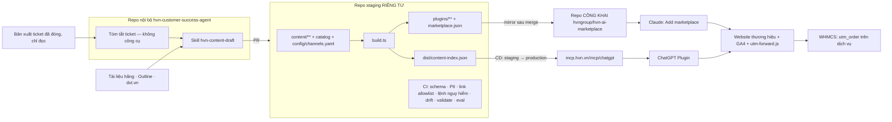

# HVN AI Plugin Marketplace — đợt 1

## Overview

HVN GROUP phát hành một marketplace plugin công khai gồm **hvn-advisor** và 6 plugin chuyên sâu: hvn-claude, hvn-chatgpt, hvn-gemini, hvn-google-workspace, hvn-microsoft-365, hvn-security. Plugin hướng dẫn người dùng bằng tiếng Việt cách dùng tốt sản phẩm, kèm gợi ý giải pháp của 14 thương hiệu HVN qua link UTM tới trang thông tin.

Đợt 1 phát hành trên hai nền tảng:
- **Claude:** marketplace HVN tự host trên GitHub.
- **ChatGPT:** plugin chạy trên MCP server công khai.

Gemini, Grok, Cursor và Antigravity dùng lại cùng lõi ở các đợt sau.

**Nguồn quyết định:**
- Phiên tư vấn `/ak:advise` ngày 2026-10-21, phạm vi đã được CEO xác nhận.
- [Báo cáo nghiên cứu Claude plugin marketplace](../reports/researcher-261021-1130-claude-plugin-marketplace.md).
- [Báo cáo nghiên cứu ChatGPT Plugins, MCP, WHMCS](../reports/researcher-261021-1130-chatgpt-apps-mcp-whmcs.md).

## Quyết định đã chốt (không đảo ngược nếu không có bằng chứng mới)

1. **Không đăng nhập, không đọc dữ liệu khách hàng lúc chạy, không hiển thị giá.** Nội dung công khai.
2. **Đo chuyển đổi bằng link UTM** tới trang thông tin trên website thương hiệu. Không thu lead trong chat.
3. **Mức up-sell theo kênh.** Cả hai kênh dùng chung code, chỉ khác cấu hình:
   - Claude: "chủ động mạnh". Mọi tài liệu kết thúc bằng khối gợi ý, tối đa 3 mục.
   - ChatGPT: "chỉ khi liên quan", để tuân thủ chính sách của OpenAI.
4. **1 plugin cốt lõi + 6 plugin chuyên sâu.** Mỗi AI một plugin riêng.
5. **Nội dung do AI sinh, người duyệt.** Tiếng Việt trước.
6. **Thứ tự nền tảng:** Claude và ChatGPT ở đợt 1; Gemini và Grok ở đợt 2; Cursor và Antigravity ở đợt 3.
7. **Nhân lực:** dev nội bộ (#Giant) dùng Claude Code, 6–8 tuần.

## Kiến trúc

## Phases

| # | Phase | Status |
|---|-------|--------|
| 1 | [Nền móng repo + lát cắt dọc trên Claude](./phase-01-repo-foundation-claude-slice.md) | Pending |
| 2 | [Pipeline nội dung AI + cổng duyệt](./phase-02-content-pipeline-review-gate.md) | Pending |
| 3 | [MCP server công khai](./phase-03-public-mcp-server.md) | Pending |
| 4 | [ChatGPT Plugin](./phase-04-chatgpt-app.md) | Pending |
| 5 | [Sản xuất nội dung 7 plugin](./phase-05-content-production-7-plugins.md) | Pending |
| 6 | [Đo lường & quy doanh thu](./phase-06-tracking-attribution.md) | Pending |
| 7 | [Ra mắt & phân phối](./phase-07-launch-distribution.md) | Pending |

## Lịch & phụ thuộc

| Tuần | Việc |
|---|---|
| 1 | P1: các spike nền tảng, repo, hợp đồng dữ liệu. P4: bắt đầu xác minh tổ chức OpenAI, soạn trang pháp lý. P6: spike giỏ hàng WHMCS. CEO chốt người duyệt. |
| 2 | P2. P5 bắt đầu từ giữa tuần (ưu tiên GWS, M365). **Mốc quyết định ChatGPT (P4).** |
| 3 | P3 (staging, CD, load test). P4: thử nghiệm 8 ca. |
| 4 | P4: nộp hồ sơ. P5 tiếp tục. **Mốc năng lực duyệt (P5).** |
| 5–6 | P5, P6 triển khai. |
| 6–8 | P7. Dự phòng thời gian chờ OpenAI duyệt. |

Phụ thuộc giữa các phase:
- P2, P3 và P6 phụ thuộc P1.
- P4 phụ thuộc P3.
- P5 phụ thuộc P2.
- P7 phụ thuộc P4 (đã nộp hoặc đã có quyết định lùi), P5 và P6.

## Dependencies

Ngoài repo:
- **GitHub:** tổ chức `hvngroup` đã xác minh quyền sở hữu, verified domain `hvn.vn`, bắt buộc 2FA.
- **OpenAI:** tài khoản tổ chức đã xác minh, workspace ChatGPT Business.
- **Hạ tầng (HVN Cloud):** DNS `mcp.hvn.vn` và `staging-mcp.hvn.vn`, VPS, registry container.
- **WHMCS:** quyền trên bản dev và production, cùng bản xuất ticket đã đóng chỉ đọc.
- **Website:** quyền chỉnh các website thương hiệu.
- **Phê duyệt:**
  - CMO duyệt nội dung marketing.
  - HVN Security duyệt chính sách quyền riêng tư, nội dung tuân thủ, và việc xử lý ticket bằng LLM.

## Success Criteria

**Done means (kiểm chứng được):**
- [ ] `claude plugin validate` đạt exit 0 cho marketplace và từng plugin.
- [ ] Cài được 7 plugin trên Claude Code và trên các loại tài khoản claude.ai đã ghi trong `docs/cai-dat.md`.
- [ ] Eval 7 plugin đạt: chọn đúng skill ≥80%, có khối gợi ý ≥90%.
- [ ] ChatGPT Plugin đạt 8/8 ca thử và đã nộp, hoặc có biên bản quyết định lùi tại mốc tuần 2.
- [ ] Mỗi plugin chuyên sâu có ít nhất N item đã duyệt, đếm bằng `npm run check -- --summary` (N ở Validation Log).
- [ ] CI chặn 100% các trường hợp sau ở mọi file nguồn, mỗi luật có test âm tính:
  - link HVN viết tay;
  - link ngoài allowlist;
  - link tới trang thanh toán;
  - PII (email, domain, IP, mã dịch vụ);
  - lệnh tải và chạy script;
  - file không thuộc whitelist trong plugin;
  - drift giữa nguồn và file sinh tự động.
- [ ] Repo công khai chỉ chứa commit đã merge của staging.
- [ ] MCP có staging, CD, rollback đã diễn tập, uptime monitor, và log không chứa truy vấn hay IP.
- [ ] GA4 ghi nhận click theo plugin. WHMCS lưu `utm_order` cho cả đơn chuyển khoản. Tỷ lệ thất thoát đã đo.
- [ ] Trang `hvn.vn/ai-plugin` đã đăng. Email WHMCS của các nhóm sản phẩm có link tới trang này. Baseline được lưu ngoài git.

**Chỉ số sau 90 ngày** (nguồn và công thức ở Phase 6; CEO chốt mục tiêu):
- Lượt cài đại diện.
- CTR ChatGPT, đề xuất ≥2%.
- Click Claude theo plugin.
- Số dịch vụ có `utm_medium=ai-plugin` và doanh thu tương ứng.
- Ticket theo danh sách từ khóa cố định, so với baseline.

## Out of scope

- Đăng nhập id.hvn.vn, hoặc đọc WHMCS lúc chạy.
- Hiển thị giá.
- Thu lead trong chat.
- Nội dung tiếng Anh.
- Phát hành chính thức trên Gemini, Grok, Cursor và Antigravity. Endpoint MCP cho các kênh này chỉ mở ở đợt sau.
- Nộp lên Anthropic directory (xem Validation Log).

## Rủi ro chính

| Rủi ro | Biện pháp |
|---|---|
| OpenAI từ chối vì nội dung mang tính quảng cáo hoặc bán hàng số | Mức `relevant`. Chỉ link trang thông tin. Dự phòng hai bậc: `tools_disabled`, rồi `exclude_types`. Có mốc quyết định tuần 2. (P3, P4) |
| Lộ dữ liệu khách hàng từ ticket | Chỉ soạn trong repo staging riêng tư. Tóm tắt ticket bằng lời gọi không công cụ. Quét PII nhiều lớp. Có runbook gỡ nội dung. (P1, P2) |
| Chèn mã hoặc lệnh qua nội dung, PR hoặc chuỗi cung ứng | Whitelist loại file và domain link. Chặn lệnh nguy hiểm. CODEOWNERS toàn repo. CI chỉ có quyền đọc. Không dùng gray-matter. (P1) |
| Năng lực duyệt không theo kịp ~210 item | Người duyệt có tên và số giờ. Mốc tuần 4 bằng số tuyệt đối. (P5) |
| Mất dấu UTM giữa website và WHMCS | Spike sớm. Cookie 30 ngày. Kiểm tra theo pattern. Đo tỷ lệ thất thoát. (P6) |
| Gemini app không cho thêm connector tùy chỉnh ở Việt Nam | Đợt 2 dùng Gemini CLI hoặc Antigravity. Khách Workspace dùng hvn-gemini trên Claude và ChatGPT. |

## Red Team Review

### Session — 2026-10-21

**Findings:** 15, sau khi gộp các điểm trùng từ 39 phát hiện của 4 reviewer. Kết quả: 15 chấp nhận, 0 bác bỏ.
**Severity breakdown:** 6 Critical, 8 High, 1 Medium.

| # | Finding | Severity | Disposition | Applied To |
|---|---------|----------|-------------|------------|
| 1 | PR nháp trên repo công khai làm lộ dữ liệu ticket trước khi duyệt | Critical | Accept | P1, P2 |
| 2 | Ticket do khách viết có thể chèn lệnh hoặc link độc | Critical | Accept | P1, P2 |
| 3 | CODEOWNERS chỉ phủ `plugins/**`; không có whitelist loại file; tên tổ chức GitHub chưa giữ | Critical | Accept | P1, P7 |
| 4 | Không có đường cập nhật, thu hồi hay deploy lại | Critical | Accept | P2, P3, P7 |
| 5 | Không đo việc chọn skill và hiển thị khối gợi ý | Critical | Accept | P1, P5, P7 |
| 6 | Mốc nộp ChatGPT tuần 4 thiếu đầu vào | Critical | Accept | P4, P5 |
| 7 | Index theo skill, không theo item | High | Accept | P1, P3, P5 |
| 8 | Dòng chỉ dẫn của Claude và UTM Claude lọt sang ChatGPT; nội dung "chọn gói" | High | Accept | P1, P3, P4 |
| 9 | UTM và `needs` không có nguồn duy nhất | High | Accept | P1, P3, P6, P7 |
| 10 | Rate limit theo IP; thiếu giới hạn input, giám sát, staging | High | Accept | P3 |
| 11 | Chính sách quyền riêng tư mâu thuẫn với thiết kế | High | Accept | P3, P4 |
| 12 | Quyền CI và gray-matter thực thi `---js` | High | Accept | P1, P3 |
| 13 | Hook WHMCS: điểm bắt UTM, phạm vi chạy, kill switch, XSS | High | Accept | P6 |
| 14 | Năng lực duyệt, thiếu Validation Log, chỉ số không có nguồn, hết hạn đồng loạt | High | Accept | P5, P6, plan.md |
| 15 | Ánh xạ email theo kênh, thử cài nhiều loại tài khoản, xung đột file sinh tự động, phần làm sẵn cho đợt sau | Medium | Accept | P1, P3, P7 |

### Whole-Plan Consistency Sweep

**Thuật ngữ cũ đã thay:**
- `upsell.yaml` và `utm.yaml` → `config/channels.yaml`.
- `references/hvn-goi-y.md` và câu chỉ dẫn "đọc và làm theo" → khối gợi ý nhúng sẵn vào từng tài liệu.
- `npm run stats` → `npm run check -- --summary`.
- `/mcp/{5 kênh}` → `/mcp/chatgpt` cho đợt 1.
- `gray-matter` → `yaml`.
- Node 22 → Node 24 LTS.
- `hvn-reviewed` theo tháng → `reviewed` ngày đầy đủ, kèm `review_sla_days`.
- Hook WHMCS: 3 hook → 2 hook.
- Đơn vị nội dung: skill → item.

**Kết quả kiểm tra:** đã grep toàn bộ file trong plan. Chỉ còn `hvn-goi-y` ở Phase 3, nằm trong một test âm tính có chủ đích. Không còn mâu thuẫn chưa xử lý.

## Validation Log

### Session 1 — 2026-10-21

_Đang chờ trả lời: N, người duyệt, giấy phép nội dung, cấu hình nộp ChatGPT, Anthropic directory, quyền truy cập của repo nội bộ._
