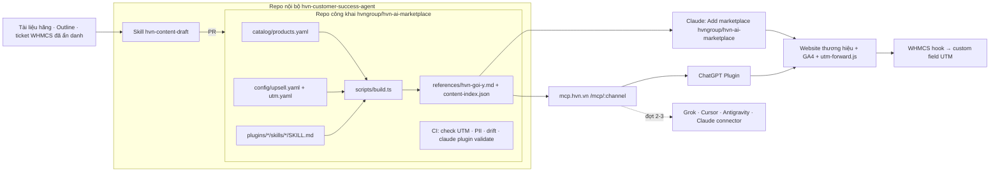

# HVN AI Plugin Marketplace — đợt 1

## Overview

HVN GROUP phát hành một marketplace plugin công khai, gồm **hvn-advisor** cùng 6 plugin chuyên sâu (hvn-claude, hvn-chatgpt, hvn-gemini, hvn-google-workspace, hvn-microsoft-365, hvn-security). Người dùng được hướng dẫn tiếng Việt để dùng tốt sản phẩm, kèm gợi ý giải pháp của 14 thương hiệu HVN qua link UTM tới trang thông tin.

Đợt 1 phát hành trên Claude (marketplace HVN tự host trên GitHub) và ChatGPT (plugin chạy trên MCP server công khai). Gemini, Grok, Cursor và Antigravity dùng lại cùng lõi ở các đợt sau.

Nguồn quyết định:

- Phiên tư vấn `/ak:advise` ngày 2026-10-21, phạm vi đã được CEO xác nhận.
- Báo cáo nghiên cứu: [Claude plugin marketplace](../reports/researcher-261021-1130-claude-plugin-marketplace.md); [ChatGPT Plugins, MCP, WHMCS](../reports/researcher-261021-1130-chatgpt-apps-mcp-whmcs.md).

## Quyết định đã chốt (không đảo ngược nếu không có bằng chứng mới)

1. **Không đăng nhập, không đọc dữ liệu khách hàng, không hiển thị giá.** Plugin dùng nội dung công khai.
2. **Đo chuyển đổi bằng link UTM** tới website thương hiệu; không thu lead trong chat.
3. **Mức up-sell theo kênh:**
   - Claude: "chủ động mạnh", mọi câu trả lời có khối gợi ý, tối đa 3 mục.
   - ChatGPT: "chỉ khi liên quan", để đáp ứng chính sách của OpenAI.
   - Cả hai cùng code, khác cấu hình.
4. **Cấu trúc gồm 1 plugin cốt lõi và 6 plugin chuyên sâu,** mỗi AI một plugin riêng, không gộp.
5. **Nội dung do AI sinh và người duyệt,** tiếng Việt trước.
6. **Thứ tự nền tảng:** Claude và ChatGPT ở đợt 1; Gemini và Grok đợt 2; Cursor và Antigravity đợt 3.
7. **Nguồn lực và thời hạn:** dev nội bộ (#Giant) dùng Claude Code, 6–8 tuần.

## Kiến trúc

## Phases

| # | Phase | Status |
|---|-------|--------|
| 1 | [Nền móng repo + lát cắt dọc trên Claude](./phase-01-repo-foundation-claude-slice.md) | Pending |
| 2 | [Pipeline nội dung AI + cổng duyệt](./phase-02-content-pipeline-review-gate.md) | Pending |
| 3 | [MCP server công khai](./phase-03-public-mcp-server.md) | Pending |
| 4 | [ChatGPT Plugin](./phase-04-chatgpt-app.md) | Pending |
| 5 | [Sản xuất nội dung 7 plugin](./phase-05-content-production-7-plugins.md) | Pending |
| 6 | [Đo lường & quy doanh thu](./phase-06-tracking-attribution.md) | Pending |
| 7 | [Ra mắt & phân phối](./phase-07-launch-distribution.md) | Pending |

## Lịch & phụ thuộc

| Tuần | Phase |
|---|---|
| 1 | P1 (và bắt đầu xác minh tổ chức OpenAI, bước 1 của P4) |
| 2 | P2, bắt đầu P5 |
| 3 | P3, P4 (thử nghiệm) |
| 4 | P4 nộp hồ sơ; P5 tiếp tục |
| 5–6 | P5, P6 |
| 6–8 | P7, dự phòng cho vòng duyệt của OpenAI |

Phụ thuộc giữa các phase:

- P2, P3 và P6 phụ thuộc P1.
- P4 phụ thuộc P3.
- P5 phụ thuộc P2.
- P7 phụ thuộc P4 (đã nộp), P5 và P6.

## Dependencies

- **Ngoài repo:**
  - Tài khoản tổ chức OpenAI đã xác minh.
  - DNS `mcp.hvn.vn` và VPS do HVN Cloud cung cấp.
  - Quyền admin WHMCS dev và production.
  - Quyền chỉnh website thương hiệu.
  - CMO duyệt các nội dung marketing.
- **Không phụ thuộc plan nào khác.**

## Success Criteria

**Done means (kiểm chứng được):**

- [ ] `claude plugin validate .` đạt exit 0; cài được đủ 7 plugin trên claude.ai và Claude Code từ `hvngroup/hvn-ai-marketplace`.
- [ ] ChatGPT Plugin đã nộp, dùng chung MCP server, đạt 8/8 ca thử.
- [ ] Mỗi plugin chuyên sâu có ít nhất N nội dung đã duyệt qua PR (N chốt ở Validation).
- [ ] CI chặn 100% link thiếu UTM, link tới trang thanh toán, PII và drift của file sinh tự động.
- [ ] GA4 ghi nhận lượt click theo plugin; WHMCS lưu UTM vào custom field dịch vụ, kể cả đơn chuyển khoản.
- [ ] Email WHMCS của 5 nhóm sản phẩm có link cài plugin; đã chụp baseline trước ra mắt.

**Chỉ số sau 90 ngày** (mục tiêu đề xuất, CEO chốt):

- Lượt cài.
- CTR của khối gợi ý, đề xuất ≥2%.
- Số dịch vụ có `utm_medium=ai-plugin` và doanh thu tương ứng.
- Số ticket ở các chủ đề đã có hướng dẫn giảm so với baseline.

## Out of scope

- Đăng nhập id.hvn.vn hoặc đọc WHMCS lúc chạy.
- Hiển thị giá.
- Thu lead trong chat.
- Nội dung tiếng Anh.
- Phát hành chính thức trên Gemini, Grok, Cursor và Antigravity.
- Nộp lên Anthropic directory (xem Validation).

## Rủi ro chính

| Rủi ro | Biện pháp |
|---|---|
| OpenAI từ chối vì nội dung mang tính quảng cáo hoặc bán hàng số | Mức `relevant`, chỉ link trang thông tin; dự phòng `tools_disabled` (P3, P4) |
| Năng lực duyệt không theo kịp khoảng 216 nội dung | Theo dõi hằng tuần bằng `npm run stats`; điểm quyết định ở cuối tuần 4 (P5) |
| Sót dữ liệu khách hàng từ ticket | Hai lớp chặn: AI ẩn danh, CI quét PII; người duyệt bắt buộc tích mục ẩn danh (P2) |
| Gemini app không cho thêm connector tùy chỉnh ở Việt Nam | Đợt 2 dùng Gemini CLI hoặc Antigravity (SKILL.md, MCP); khách Workspace được phục vụ qua hvn-gemini trên Claude và ChatGPT |
| Tên plugin chứa thương hiệu bên thứ ba | Phát hành qua marketplace HVN tự host; chấp nhận cảnh báo của validator |
