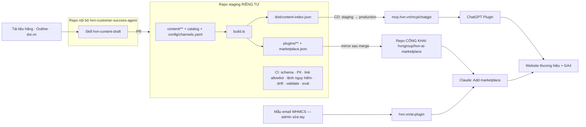

# HVN AI Plugin Marketplace — đợt 1

## Overview

HVN GROUP phát hành một marketplace plugin công khai gồm **hvn-advisor** và 6 plugin chuyên sâu: hvn-claude, hvn-chatgpt, hvn-gemini, hvn-google-workspace, hvn-microsoft-365, hvn-security. Đây là plugin **công khai** với hai mục đích: xây dựng hình ảnh HVN GROUP, và cung cấp **lộ trình onboard** cho người dùng dịch vụ. Plugin hướng dẫn tiếng Việt cách dùng tốt sản phẩm, kèm gợi ý giải pháp của 14 thương hiệu HVN qua link UTM tới trang thông tin. Plugin **không kết nối WHMCS**; WHMCS chỉ được admin dùng để sửa tay mẫu email giới thiệu plugin.

Đợt 1 phát hành trên hai nền tảng:
- **Claude:** marketplace HVN tự host trên GitHub.
- **ChatGPT:** plugin chạy trên MCP server công khai.

Gemini, Grok, Cursor và Antigravity dùng lại cùng lõi ở các đợt sau.

**Nguồn quyết định:**
- Phiên tư vấn `/ak:advise` ngày 2026-10-21, phạm vi đã được CEO xác nhận.
- [Báo cáo nghiên cứu Claude plugin marketplace](../reports/researcher-261021-1130-claude-plugin-marketplace.md).
- [Báo cáo nghiên cứu ChatGPT Plugins, MCP, WHMCS](../reports/researcher-261021-1130-chatgpt-apps-mcp-whmcs.md).

## Quyết định đã chốt (không đảo ngược nếu không có bằng chứng mới)

1. **Không đăng nhập, không hiển thị giá, không kết nối WHMCS.** Nội dung công khai. Không dùng ticket hay dữ liệu khách hàng làm nguồn. Không có hook hay báo cáo WHMCS. Admin chỉ sửa tay mẫu email trong WHMCS.
2. **Đo bằng link UTM và GA4** trên website thương hiệu. Không đo doanh thu trong WHMCS. Không thu lead trong chat.
3. **Mức up-sell theo kênh.** Cả hai kênh dùng chung code, chỉ khác cấu hình:
   - Claude: "chủ động mạnh". Mọi tài liệu kết thúc bằng khối gợi ý, tối đa 3 mục. *(Session 3: câu trả lời chỉ giới thiệu mục phù hợp nhất trong 1–2 câu tự nhiên, không chép nguyên khối.)*
   - ChatGPT: "chỉ khi liên quan", để tuân thủ chính sách của OpenAI.
4. ~~**1 plugin cốt lõi + 6 plugin chuyên sâu.** Mỗi AI một plugin riêng.~~ Thay bằng **một plugin `tech-advisor` tên trung lập, 7 chủ đề** (Validation Session 3, 23/10/2026).
5. **Nội dung do AI sinh, người duyệt.** Tiếng Việt trước. Mỗi plugin chuyên sâu có 1 **lộ trình onboard** (Ngày 1, Tuần 1, Tháng 1, Tháng 3).
6. **Thứ tự nền tảng:** Claude và ChatGPT ở đợt 1; Gemini và Grok ở đợt 2; Cursor và Antigravity ở đợt 3.
7. **Nhân lực:** dev nội bộ (#Giant) dùng Claude Code, 6–8 tuần.

## Kiến trúc

## Phases

| # | Phase | Status |
|---|-------|--------|
| 1 | [Nền móng repo + lát cắt dọc trên Claude](./phase-01-repo-foundation-claude-slice.md) | Pending |
| 2 | [Pipeline nội dung AI + cổng duyệt](./phase-02-content-pipeline-review-gate.md) | Pending |
| 3 | [MCP server công khai](./phase-03-public-mcp-server.md) | Pending |
| 4 | [ChatGPT Plugin](./phase-04-chatgpt-app.md) | Pending |
| 5 | [Sản xuất nội dung 7 plugin](./phase-05-content-production-7-plugins.md) | Pending |
| 6 | [Đo lường bằng GA4](./phase-06-tracking-attribution.md) | Pending |
| 7 | [Ra mắt & phân phối](./phase-07-launch-distribution.md) | Pending |

## Lịch & phụ thuộc

| Tuần | Việc |
|---|---|
| 1 | P1: các spike nền tảng, repo, hợp đồng dữ liệu. P4: bắt đầu xác minh tổ chức OpenAI, soạn trang pháp lý. CEO chốt người duyệt. |
| 2 | P2. P5 bắt đầu từ giữa tuần (ưu tiên GWS, M365). **Mốc quyết định ChatGPT (P4).** |
| 3 | P3 (staging, CD, load test). P4: thử nghiệm 8 ca. |
| 4 | P4: nộp hồ sơ. P5 tiếp tục. **Mốc năng lực duyệt (P5).** |
| 5–6 | P5. P6 (GA4, key event, báo cáo). |
| 6–8 | P7. Dự phòng thời gian chờ OpenAI duyệt. |

Phụ thuộc giữa các phase:
- P2, P3 và P6 phụ thuộc P1.
- P4 phụ thuộc P3.
- P5 phụ thuộc P2.
- P7 phụ thuộc P4 (đã nộp hoặc đã có quyết định lùi), P5 và P6.

## Dependencies

Ngoài repo:
- **GitHub:** tổ chức `hvngroup` đã xác minh quyền sở hữu, verified domain `hvn.vn`, bắt buộc 2FA.
- **OpenAI:** tài khoản tổ chức đã xác minh, workspace ChatGPT Business.
- **Hạ tầng (HVN Cloud):** DNS `mcp.hvn.vn` và `staging-mcp.hvn.vn`, VPS, registry container.
- **WHMCS:** chỉ cần admin có quyền sửa mẫu email. Không tích hợp dữ liệu.
- **Website:** quyền chỉnh các website thương hiệu.
- **Phê duyệt:**
  - CMO duyệt nội dung marketing.
  - HVN Security duyệt chính sách quyền riêng tư và nội dung tuân thủ.

## Success Criteria

**Done means (kiểm chứng được):**
- [ ] `claude plugin validate` đạt exit 0 cho marketplace và từng plugin.
- [ ] Cài được 7 plugin trên Claude Code và trên các loại tài khoản claude.ai đã ghi trong `docs/cai-dat.md`.
- [ ] Eval 7 plugin đạt: chọn đúng skill ≥80%, có khối gợi ý ≥90%.
- [ ] ChatGPT Plugin đạt 8/8 ca thử và đã nộp, hoặc có biên bản quyết định lùi tại mốc tuần 2.
- [ ] Mỗi plugin chuyên sâu có ít nhất **35** item đã duyệt (tổng 210), trong đó có 1 lộ trình onboard. Số liệu đếm bằng `npm run check -- --summary`.
- [ ] CI chặn 100% các trường hợp sau ở mọi file nguồn, mỗi luật có test âm tính:
  - link HVN viết tay;
  - link ngoài allowlist;
  - link tới trang thanh toán;
  - PII (email, domain, IP, mã dịch vụ);
  - lệnh tải và chạy script;
  - file không thuộc whitelist trong plugin;
  - drift giữa nguồn và file sinh tự động.
- [ ] Repo công khai chỉ chứa commit đã merge của staging.
- [ ] MCP có staging, CD, rollback đã diễn tập, uptime monitor, và log không chứa truy vấn hay IP.
- [ ] GA4 ghi nhận click theo plugin và nội dung. Key event đã đánh dấu trên các domain đích. Không có tích hợp WHMCS nào trong mã nguồn.
- [ ] Trang `hvn.vn/ai-plugin` đã đăng. Mẫu email WHMCS của các nhóm sản phẩm có khối lộ trình onboard và link tới trang này. Baseline GA4 lưu ngoài git.

**Chỉ số sau 90 ngày** (nguồn và công thức ở Phase 6; CEO chốt mục tiêu):
- Lượt cài đại diện.
- CTR ChatGPT, đề xuất ≥2%.
- Click Claude theo plugin.
- Key event trên website trong các phiên `utm_medium=ai-plugin`.
- Lượt mở lộ trình onboard theo plugin.

## Out of scope

- Đăng nhập id.hvn.vn. Mọi tích hợp dữ liệu với WHMCS: ticket, hook, custom field, báo cáo doanh thu.
- Hiển thị giá.
- Thu lead trong chat.
- Nội dung tiếng Anh.
- Phát hành chính thức trên Gemini, Grok, Cursor và Antigravity. Endpoint MCP cho các kênh này chỉ mở ở đợt sau.
- Nộp lên Anthropic directory (xem Validation Log).

## Rủi ro chính

| Rủi ro | Biện pháp |
|---|---|
| OpenAI từ chối vì nội dung mang tính quảng cáo hoặc bán hàng số | Mức `relevant`. Chỉ link trang thông tin. Loại `chon-goi` ngay từ lần nộp đầu. Dự phòng: tắt `recommend_solutions`. Có mốc quyết định tuần 2. (P3, P4) |
| Lộ thông tin không được phép lên repo công khai | Không dùng dữ liệu WHMCS. Chỉ soạn trong repo staging riêng tư. Quét PII nhiều lớp. Có runbook gỡ nội dung. (P1, P2) |
| Chèn mã hoặc lệnh qua nội dung, PR hoặc chuỗi cung ứng | Whitelist loại file và domain link. Chặn lệnh nguy hiểm. CODEOWNERS toàn repo. CI chỉ có quyền đọc. Không dùng gray-matter. (P1) |
| Năng lực duyệt không theo kịp ~210 item | Người duyệt có tên và số giờ. Mốc tuần 4 bằng số tuyệt đối. (P5) |
| Không đo được doanh thu (đã chấp nhận) | Ra quyết định dựa trên click, key event, lượt cài. Muốn đo doanh thu thì lập plan riêng. (P6) |
| Gemini app không cho thêm connector tùy chỉnh ở Việt Nam | Đợt 2 dùng Gemini CLI hoặc Antigravity. Khách Workspace dùng hvn-gemini trên Claude và ChatGPT. |

## Red Team Review

### Session — 2026-10-21

**Findings:** 15, sau khi gộp các điểm trùng từ 39 phát hiện của 4 reviewer. Kết quả: 15 chấp nhận, 0 bác bỏ.
**Severity breakdown:** 6 Critical, 8 High, 1 Medium.

| # | Finding | Severity | Disposition | Applied To |
|---|---------|----------|-------------|------------|
| 1 | PR nháp trên repo công khai làm lộ dữ liệu ticket trước khi duyệt | Critical | Accept | P1, P2 |
| 2 | Ticket do khách viết có thể chèn lệnh hoặc link độc | Critical | Accept | P1, P2 |
| 3 | CODEOWNERS chỉ phủ `plugins/**`; không có whitelist loại file; tên tổ chức GitHub chưa giữ | Critical | Accept | P1, P7 |
| 4 | Không có đường cập nhật, thu hồi hay deploy lại | Critical | Accept | P2, P3, P7 |
| 5 | Không đo việc chọn skill và hiển thị khối gợi ý | Critical | Accept | P1, P5, P7 |
| 6 | Mốc nộp ChatGPT tuần 4 thiếu đầu vào | Critical | Accept | P4, P5 |
| 7 | Index theo skill, không theo item | High | Accept | P1, P3, P5 |
| 8 | Dòng chỉ dẫn của Claude và UTM Claude lọt sang ChatGPT; nội dung "chọn gói" | High | Accept | P1, P3, P4 |
| 9 | UTM và `needs` không có nguồn duy nhất | High | Accept | P1, P3, P6, P7 |
| 10 | Rate limit theo IP; thiếu giới hạn input, giám sát, staging | High | Accept | P3 |
| 11 | Chính sách quyền riêng tư mâu thuẫn với thiết kế | High | Accept | P3, P4 |
| 12 | Quyền CI và gray-matter thực thi `---js` | High | Accept | P1, P3 |
| 13 | Hook WHMCS: điểm bắt UTM, phạm vi chạy, kill switch, XSS | High | Accept, sau đó **không còn áp dụng** vì đã bỏ hook (Validation Session 2) | P6 |
| 14 | Năng lực duyệt, thiếu Validation Log, chỉ số không có nguồn, hết hạn đồng loạt | High | Accept | P5, P6, plan.md |
| 15 | Ánh xạ email theo kênh, thử cài nhiều loại tài khoản, xung đột file sinh tự động, phần làm sẵn cho đợt sau | Medium | Accept | P1, P3, P7 |

### Whole-Plan Consistency Sweep

**Thuật ngữ cũ đã thay:**
- `upsell.yaml` và `utm.yaml` → `config/channels.yaml`.
- `references/hvn-goi-y.md` và câu chỉ dẫn "đọc và làm theo" → khối gợi ý nhúng sẵn vào từng tài liệu.
- `npm run stats` → `npm run check -- --summary`.
- `/mcp/{5 kênh}` → `/mcp/chatgpt` cho đợt 1.
- `gray-matter` → `yaml`.
- Node 22 → Node 24 LTS.
- `hvn-reviewed` theo tháng → `reviewed` ngày đầy đủ, kèm `review_sla_days`.
- Hook WHMCS: 3 hook → 2 hook.
- Đơn vị nội dung: skill → item.

**Kết quả kiểm tra:** đã grep toàn bộ file trong plan. Chỉ còn `hvn-goi-y` ở Phase 3, nằm trong một test âm tính có chủ đích. Không còn mâu thuẫn chưa xử lý.

## Validation Log

### Session 1 — 2026-10-21

**Câu hỏi đã hỏi:** 6. **Người trả lời:** CEO.

| # | Câu hỏi | Quyết định | Lan tới |
|---|---|---|---|
| 1 | Định mức N | **35 item cho mỗi plugin chuyên sâu (tổng 210).** Đã giữ nguyên dù có cảnh báo về năng lực duyệt; mốc tuần 4 ở P5 là van an toàn. | P5, Done means |
| 2 | 2 người duyệt nội dung | **1 biên tập viên Content (#Valkyrie) + 1 kỹ thuật viên Service (#Witch).** Tên cụ thể và số giờ mỗi tuần do COO/CMO chỉ định trong tuần 1, rồi ghi bổ sung vào đây. | P1 (CODEOWNERS), P5 |
| 3 | Giấy phép nội dung | **MIT cho mã. Nội dung © HVN GROUP:** được cài, dùng và mirror nội bộ, kể cả doanh nghiệp khách hàng; cấm tái phân phối công khai hay bán lại. | P1 |
| 4 | Cấu hình nộp ChatGPT | **Giữ `recommend_solutions`, loại `chon-goi` (`exclude_types: [chon-goi]`).** Dự phòng: tắt `recommend_solutions`. | P1 (channels.yaml), P3, P4 |
| 5 | Anthropic directory | ~~**Không nộp ở đợt 1.** Xem xét lại sau 90 ngày.~~ Thay bằng: **chuẩn bị nộp ngay** (Validation Session 4, 23/10/2026). | Out of scope → P7 |
| 6 | Quyền truy cập repo `hvn-customer-success-agent` | **Riêng tư.** Plan, báo cáo và skill soạn nội dung được phép nằm ở đây. | P2 |

**Tác động:**
- N = 35 nghĩa là khoảng 47 item mỗi tuần, mỗi người duyệt khoảng 2,5 giờ mỗi ngày.
- Mốc cuối tuần 4: tổng item đã merge của 6 plugin phải đạt ít nhất **105**, nếu không CEO quyết định thêm người duyệt hoặc hạ N.

### Verification Results
- Claims checked: 21 (Standard tier, 7 phase), gồm tên file, tên trường, lệnh và đường dẫn được tham chiếu chéo giữa các phase và báo cáo nghiên cứu.
- Verified: 21 | Failed: 0 | Unverified: 6. Các mục Unverified đã được gắn nhãn trong phase và có spike hoặc bước kiểm tra cụ thể:
  - tên miền `mcp.hvn.vn`;
  - URL trang đích trong catalog;
  - key `annotations` của SDK v2;
  - phiên bản spec MCP mà ChatGPT dùng;
  - gói ChatGPT hỗ trợ custom MCP;
  - Việt Nam có trong danh sách quốc gia phát hành.
- Tier: Standard. Repo đang trống mã nguồn, nên việc kiểm chứng dựa trên các file plan và báo cáo nghiên cứu.

### Whole-Plan Consistency Sweep
- Đã thay `exclude_types: []` bằng `[chon-goi]` (P1). Phương án dự phòng của P4 rút còn một bậc. Bảng rủi ro trong `plan.md` đã cập nhật.
- Đã điền N=35 vào Done means. Đã ghi vai trò người duyệt ở P1 và P5. Đã ghi giấy phép ở P1.
- Không còn tham chiếu nào tới một mục "Validation" chưa tồn tại.

### Session 2 — 2026-10-21

**Câu hỏi đã hỏi:** 4. **Người trả lời:** CEO.

| # | Câu hỏi | Quyết định | Lan tới |
|---|---|---|---|
| 1 | Phạm vi dùng WHMCS | **Admin chỉ sửa tay mẫu email.** Plugin không kết nối WHMCS. Bỏ ticket làm nguồn nội dung, bỏ hook và custom field `utm_order`, bỏ spike giỏ hàng, bỏ báo cáo doanh thu và baseline lấy từ WHMCS. | P2, P6, P7, plan.md |
| 2 | Mục đích plugin | **Plugin công khai để xây dựng hình ảnh và cung cấp lộ trình onboard cho người dùng dịch vụ.** | Overview |
| 3 | Lộ trình onboard | **Thêm loại `lo-trinh`, mỗi plugin chuyên sâu có 1 item, tính trong N=35** (playbook giảm từ 10 xuống 9). | P1 (schema, check), P2 (template), P5, P7 (email) |
| 4 | Cross-sell | **Giữ như đã chốt:** Claude ở mức chủ động mạnh, ChatGPT chỉ khi liên quan. | — |

**Thay đổi so với Session 1:**
- Phase 6 rút từ 5 ngày còn 2 ngày và chỉ dùng GA4.
- Phase 2 bỏ bước tóm tắt ticket và bỏ điều kiện cần HVN Security xác nhận việc xử lý ticket bằng LLM.
- Red Team #1 và #2 vẫn áp dụng cho nguồn tài liệu công khai: dùng repo staging riêng tư, whitelist link, chặn lệnh nguy hiểm.

### Whole-Plan Consistency Sweep (Session 2)
- Đã grep `whmcs|ticket|utm_order|doanh thu` trên toàn bộ file plan.
- Các chỗ còn nhắc WHMCS đều đúng với phạm vi mới:
  - mẫu email (P7);
  - `utm_medium=whmcs` cho link trong email (P1);
  - luật quét mã dịch vụ WHMCS trong `check.ts`, dùng để phòng lọt dữ liệu;
  - tên file báo cáo nghiên cứu;
  - các dòng lịch sử trong Red Team Review.
- Không còn mâu thuẫn chưa xử lý.

### Session 3 — 2026-10-23

**Người quyết định:** CEO, sau khi dùng thử plugin trên claude.ai.

| # | Câu hỏi | Quyết định | Lan tới |
|---|---|---|---|
| 1 | Giọng văn khi gợi ý giải pháp | **Tư vấn như chuyên gia độc lập, nhắc HVN GROUP ở ngôi thứ ba.** Không dùng mã giải pháp (S01…S22), không lời lẽ quảng cáo. Cuối câu trả lời chỉ giới thiệu mục phù hợp nhất trong 1–2 câu tự nhiên, thay cho việc chép nguyên khối gợi ý. | P1 (build, check), P2 (style guide), P5 (eval: `has_block` = có câu giới thiệu) |
| 2 | Số plugin trên Claude | **Một plugin `tech-advisor` (tên hiển thị "Tech Advisor"), không có chữ HVN trong tên.** 7 plugin cũ thành 7 chủ đề. Mã tài liệu và `utm_campaign` vẫn theo chủ đề. | P1, P5, P7 (trang cài đặt, email) |
| 3 | Mở rộng sang đối tác | **Đối tác mới chỉ thêm dòng vào catalog.** Chỉ thêm chủ đề khi cần hướng dẫn chuyên sâu. Không tạo plugin mới. | P5 |

**Tác động:**
- N = 35 giờ tính cho mỗi chủ đề chuyên sâu (tổng 210 không đổi). `npm run check -- --summary` đếm theo chủ đề.
- Eval chạy với một plugin `tech-advisor` đã cài. Ngưỡng giữ nguyên.
- Khi tổng số skill vượt khoảng 60–80 hoặc eval chọn đúng skill dưới 80%, cân nhắc chuyển plugin Claude sang dùng MCP server chung với ChatGPT.

### Session 4 — 2026-10-23

**Người quyết định:** CEO.

| # | Câu hỏi | Quyết định | Lan tới |
|---|---|---|---|
| 1 | Khách Team và Enterprise cài cho cả tổ chức, không sao chép repo, vẫn nhận cập nhật | Trang cài đặt hướng dẫn 4 cách: thư mục Anthropic (sau khi niêm yết); repo GitHub riêng tư của khách chỉ chứa một `marketplace.json` trỏ tới `plugins/tech-advisor` qua `git-subdir` (cần tài khoản GitHub miễn phí, bấm Re-sync khi có bản mới); từng thành viên tự thêm; managed settings cho Claude Code. | P7 (`docs/phan-phoi/cai-dat.md`) |
| 2 | Anthropic directory | **Chuẩn bị nộp ngay**, đảo quyết định Session 1 #5. Hồ sơ: `submission/claude-directory/README.md` ở repo staging. Validate sớm để biết vấn đề về tên; chỉ Submit for review khi các chủ đề hướng dẫn có thêm bài, vì chính sách §4C không nhận phần mềm chủ yếu để quảng cáo. | P7 |
